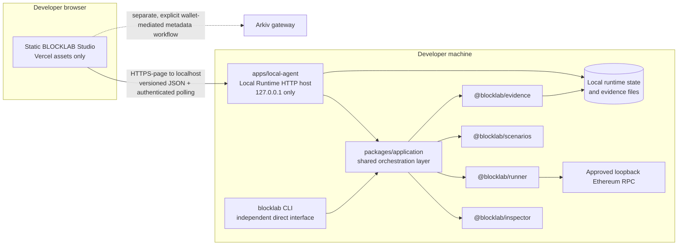
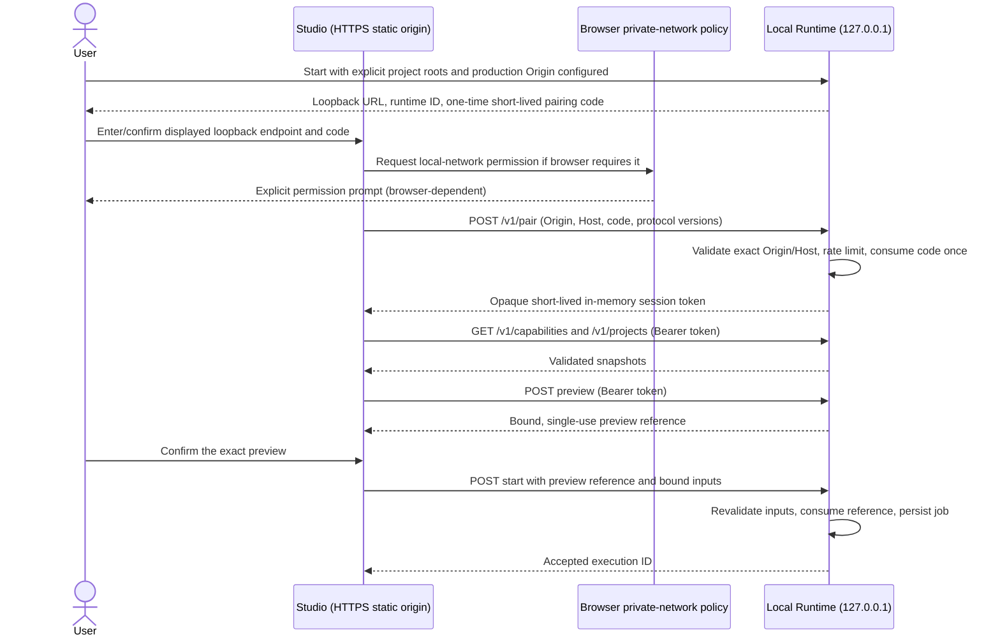
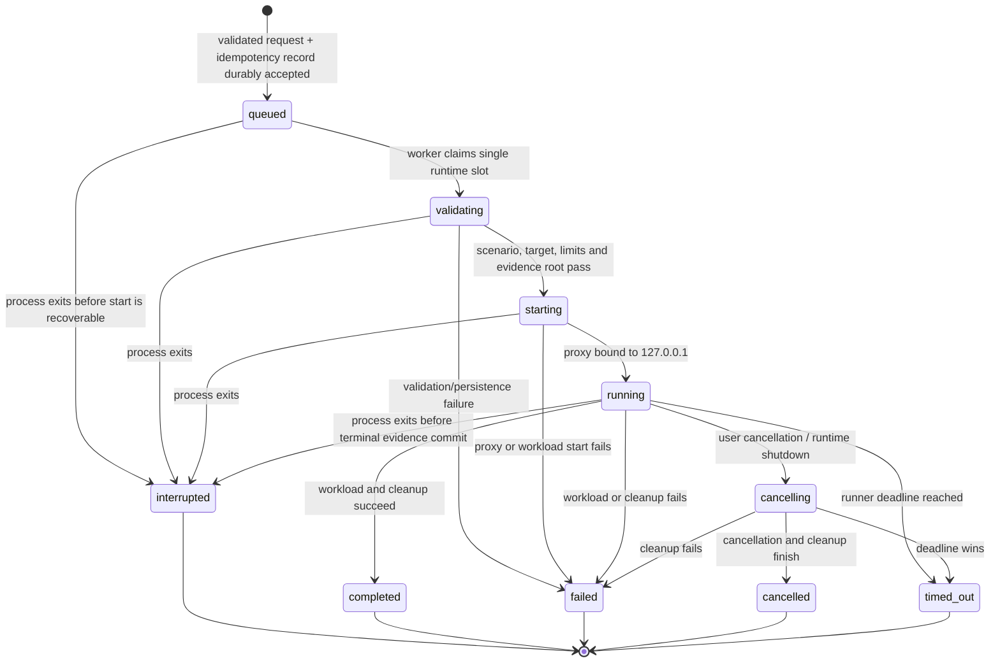

# BLOCKLAB Local Runtime Protocol

**Status:** D0.1 architecture decisions approved. D1 protocol/security
foundation, D2 shared application/orchestration extraction, Phase 2A shared
report/evidence contracts, Phase 2B read-only report APIs, and Phase 2C CLI
Quick Run handoff and Studio report wiring are implemented. Automatic
project-scoped bootstrap is available for CLI handoffs. Local Agent experiment
execution and job HTTP APIs remain unimplemented; experiments run through the
CLI only.
**Date:** 2026-11-06
**Scope:** Connect the statically hosted Studio to a developer-owned local
runtime without moving execution or detailed evidence to Vercel.

## 1. Executive summary

Studio is a static Vite application. The Local Agent is a separate,
inspect-only HTTP process.
The CLI is the only supported experiment interface; it invokes the shared
application/orchestration layer, which composes the runner, scenario
definitions, and evidence package, persists evidence on the developer's
machine, and supports listing, reporting, replay, and comparison through
CLI-specific workflows.

The Local Agent currently serves inspection and authenticated, read-only
report APIs. Experiment execution remains in the CLI; no Studio or Local Agent
HTTP route can start an experiment.

The first release should be intentionally narrow: explicit project
authorization; registration of local or remote endpoint configurations in the
Node Registry; validation and experiment execution only against approved
loopback endpoints; a single active runtime-managed experiment; the six
registered scenarios using the existing controlled, read-only `eth_chainId`
workload; authenticated status and local evidence reads; bounded cancellation;
and recoverable local state. Remote endpoint validation and execution are
deferred. Do not offer shell execution, arbitrary CLI arguments, arbitrary
files, arbitrary proxying, staging/public-network execution, signing, wallet
access, transaction submission, or browser-initiated runtime shutdown.

Use versioned JSON HTTP APIs and authenticated polling for status and progress
in the first release. Defer SSE and WebSockets. The exact HTTPS-hosted Studio
to HTTP-loopback browser behavior is a mandatory release gate.

The current implementation rotates the 128-bit pairing code after a successful
pair, rate-limits failed attempts, and supports multiple independent
ten-minute sessions. The Local Agent indexes sessions by a digest of each
bearer token; Studio retains its token only in the client closure, never in
browser storage or a URL. Shared protocol payloads are validated at runtime.
Evidence structure validation and digest verification are separate
operations: legacy evidence validation remains backward-compatible, while
report projections explicitly expose an integrity status and never assume
that JSON parsing proves authenticity.

## 2. Verified current architecture

The following describes the current implementation, not the future experiment
API proposal in section 4.

### 2.1 Studio and deployment

- `apps/studio/src/main.ts` creates `createStudioAgentClient()`, mounts the
  shell, creates `ArkivController`, and wires the wallet-mediated Arkiv
  workflow. Studio is Vite + TypeScript with DOM rendering and hash routing;
  it is not React.
- `apps/studio/src/agent.ts` exports `createStudioAgentClient()`. Its state
  subscription publishes pairing, connected, inspection, and revoke changes.
  The token is held in a closure, not in Agent state or browser storage.
  Responses are validated with the shared runtime parsers. A client reload
  loses its in-memory session.
- The CLI report handoff opens Studio on the selected report with a short-lived
  capability in the URL fragment. Studio exchanges that capability for an
  in-memory session and loads the report without manual pairing. The Projects
  workflow retains manual pairing for standalone agents and diagnostics.
- `pair()` restricts manually entered endpoints to HTTP on literal
  `127.0.0.1`, fetches `/v1/health`, posts a one-time code to `/v1/pair`, and
  then loads `/v1/projects`.
- `apps/studio/vite.config.ts` builds static assets to `dist-app`.
  `vercel.json` configures a static output and SPA fallback; it does not
  configure a runtime proxy, API server, or cloud execution service.
- The CLI defaults the Local Agent Origin allowlist to the exact deployed
  Studio origin, `https://block-lab-eight.vercel.app`, when no explicit
  origins are supplied. The standalone `blocklab-agent` entrypoint retains its
  local-development defaults unless an exact `--allowed-origin` is provided.
  The deployment remains static Studio only; it does not provide a cloud
  runtime or evidence store.

### 2.2 Local Agent

- `apps/local-agent/src/server.ts` exports `createLocalAgent()` and
  `pathIsWithinAuthorizedRoot()`. The HTTP server binds to `127.0.0.1`;
  `LocalAgentOptions` permits explicit project paths, allowed origins, an
  optional port, and a clock for tests. The default port is `0` (ephemeral).
- Project directories are resolved and authorized at startup. The Agent lists
  only authorized projects, supports read-only inspection, and reads only
  digest-verified reports from each project's configured evidence directory.
  It does not scan arbitrary directories, run project scripts, or execute
  experiments.
- Current versioned routes include `/v1/health`, `/v1/pair`,
  `/v1/bootstrap`, `/v1/session`, `/v1/projects`,
  `/v1/projects/{id}/inspect`, `/v1/projects/{id}/reports`, and
  `/v1/projects/{id}/reports/{executionId}`. Protected requests require an
  exact configured Origin, the expected Host, and a valid session token.
- Pairing codes are generated from 16 random bytes (128 bits), expire after
  five minutes, are compared using `timingSafeEqual`, and rotate after
  successful pairing. Failed attempts are rate limited.
- Pairing can create independent sessions. CLI report handoffs instead use a
  project-scoped launch capability: it expires after five minutes, permits at
  most eight exchanges, and is invalidated on Agent shutdown. Sessions contain
  32 random bytes, expire after ten minutes, are kept in process memory, and
  can be revoked independently. Runtime restart naturally loses all sessions.
- Request bodies are limited to 16 KiB and responses to 1 MiB. The default
  allowed Origins are
  `http://127.0.0.1:5178` and `http://localhost:5178`.
- `apps/local-agent/src/index.ts` requires an explicit project directory,
  starts the Agent, and closes on SIGINT/SIGTERM. The CLI starts or reuses the
  Agent for report handoffs; standalone startup supports repeated
  `--allowed-origin` options and explicit pairing.
- `apps/local-agent/src/server.test.ts` covers pairing, project listing and
  inspection, rejection of a disallowed Origin, session revocation, and path
  containment. The inspected tests do not cover pairing expiry, brute-force
  throttling, one-time pairing, request-size boundaries, response-size bounds,
  schema fuzzing, or a deployed Studio Origin.

### 2.3 CLI, runner, scenarios, and evidence

- `apps/cli/src/cli.ts` is the primary execution interface. `SUPPORTED_SCENARIOS`
  currently contains six scenarios: `rpc-blackout`, `rpc-latency`,
  `rpc-intermittent-failure`, `rpc-rate-limit`,
  `rpc-connection-failure`, and `rpc-malformed-response`.
- CLI Quick Run uses the shared application operation to compose the selected
  scenario, runner, and evidence workflow. It does not start the inspected
  dApp or use its application workload; Studio must not imply that the current
  runner tests arbitrary dApp user journeys.
- `packages/runner/src/index.ts` exports `RpcProxy`, `startExecution()`,
  `ExecutionContext`, lifecycle types, and cancellation/timeout handling.
  `startExecution()` returns an execution context and a result promise; the
  context accumulates lifecycle events and cleanup handlers. The CLI currently
  adapts an `AbortSignal` to `requestCancellation()`. This is not yet a
  persistent job manager, durable event journal, or HTTP event stream.
- `RpcProxy` binds to loopback by default and captures in-memory observations.
  `preflightExecution()` restricts targets to loopback unless a separate
  staging authorization is supplied. The browser runtime must not expose that
  staging branch. The current RPC proxy has a strict read-only method set; the
  runtime should reuse it and reject unknown methods by default, rather than
  implement a second proxy.
- `packages/scenarios/src/index.ts` exports the scenario definitions and their
  `ScenarioDefinition` metadata. The CLI's list currently identifies all six
  as supported and local-only.
- `packages/evidence/src/index.ts` exports scenario-specific evidence
  factories, `validateEvidence()`, `writeEvidence()`, `readEvidence()`,
  `listEvidence()`, `toJsonReport()`, `toReplayConfiguration()`, and
  `compareEvidence()`. Evidence includes configuration, observations,
  evaluation, limitations, and a SHA-256 digest. The writer validates,
  writes a temporary file with exclusive creation, links it into place without
  overwriting, then removes the temporary file.
- `validateEvidence()` checks schema, scenario, schedule, timestamps,
  observation structure, and that `evidenceDigest` is 64 lowercase hex
  characters. Phase 2A additionally exports explicit digest calculation and
  integrity inspection; a digest stored beside mutable evidence is not a
  signature and cannot prove authenticity against a local actor able to
  rewrite both.
- `apps/cli/src/cli.ts` stores evidence by default under the platform's
  application data directory (`%APPDATA%\\blocklab\\evidence` on Windows,
  `~/Library/Application Support/blocklab/evidence` on macOS, and
  `$XDG_DATA_HOME/blocklab/evidence` or `~/.local/share/blocklab/evidence` on
  Linux). `BLOCKLAB_EVIDENCE_DIR` and `--evidence-dir` override the location.
  CLI commands include `runs list`, `runs show`, `report`, `replay`,
  `compare`, and `studio <run-id>` for the Studio report handoff.
- `packages/core/src/index.ts` defines `AgentHealth`, `AuthorizedProject`,
  `AgentInspectionResponse`, `ScenarioDefinition`, `Experiment`, and related
  domain types. It does not define the proposed HTTP API, idempotency, durable
  runtime job, or stream-event contracts.
- `packages/application/src/index.ts` provides the shared `runExperiment`
  orchestration operation used by the CLI. It has no HTTP, Studio, Local
  Agent, or CLI-output dependency. The Local Agent does not call it.

### 2.4 Phase 2A report and evidence contract

The shared report protocol is version `1`, exported from
`@blocklab/core` (`packages/core/src/local-runtime.ts`). It defines strict
runtime parsers and these contracts:

- `ReportSummary` contains the user-facing `executionId`, immutable
  `recordId`, scenario identity, terminal state, evaluation, timestamps,
  digest when present, and `integrityStatus`.
- `ReportDetail` adds the validated scenario configuration, bounded
  baseline/fault/recovery observations, and bounded warnings/limitations.
- `ReportListResponse` contains the protocol version, authorized project
  identifier, total count, a maximum 64-item page, and an optional cursor.
- `ReportCapabilities` advertises supported read-only operations, maximum page
  size, and maximum report response bytes.

`executionId` is the user-facing report identifier. `recordId` identifies the
immutable evidence record. Both are restricted to safe identifier characters;
filesystem paths are not part of the protocol and clients cannot submit them.
The Local Agent resolves these identifiers only within its configured
evidence directory.

Report integrity is one of `verified`, `missing-digest`, `digest-mismatch`,
`unsupported-version`, `malformed`, or `oversized`. The evidence package
provides `calculateEvidenceDigest`, `verifyEvidenceDigest`,
`inspectEvidenceIntegrity`, `readEvidenceWithIntegrity`, `toReportSummary`, and
`toReportDetail`. Existing `readEvidence`, CLI report commands, and evidence
files remain compatible; digest verification is explicit and is not inferred
from successful JSON parsing.

Shared bounds are a maximum 64 report summaries per page, 512 observations per
detail response, and 1 MiB for evidence/report payloads. Individual objects
are limited to 128 keys, a complete payload to 8,192 object keys, nesting to
12 levels, strings to 4,096 characters, and arrays to 512 items. Evidence
diagnostic/warning/limitation arrays are limited to 64 entries; observation
methods are limited to 256 characters and correlation identifiers to 128
characters. Strict keys, timestamp/identifier validation, exact
scenario-version and scenario-specific configuration validation, and bounded
diagnostic strings reject malformed or unexpected data. Report diagnostics
redact URL credentials, authorization/API-key/bearer headers, secret-shaped
values, environment secret assignments, and Windows, UNC, Unix, and home
filesystem paths. The contract contains no session tokens, environment
variables, absolute paths, or arbitrary RPC request data.

`readEvidenceWithIntegrity()` is a discriminated result: only a result with
`integrity.status === "verified"` contains an `evidence` record. Missing,
mismatched, malformed, unsupported-version, and oversized evidence results
contain an integrity status and error but no evidence record. Successful JSON
parsing alone is never sufficient for verification. The digest canonical field
set and serialization order remain unchanged for compatibility; `recordId`,
warnings, and limitations remain excluded from the digest.

Phase 2A added schemas and evidence projections only. Phase 2B added the
authenticated Local Agent report routes described below, and Phase 2C wires
the existing CLI and Studio report workflow to those routes. Cloud storage and
experiment execution through the Local Agent remain unimplemented.

### 2.6 Phase 2B Local Agent report access

The Local Agent exposes the following authenticated, read-only report routes:

- `GET /v1/projects/:projectId/reports`
- `GET /v1/projects/:projectId/reports/:executionId`

The first route supports bounded `limit` (1-64) and numeric `cursor`
parameters and returns `ReportListResponse`. The second route returns
`ReportDetail`. Both routes require a valid session scoped to the explicitly
authorized project. Responses are `Cache-Control: no-store`; session tokens
remain in the Authorization header and are never accepted in URLs.

Evidence-directory ownership is established by the trusted Local Agent startup
configuration: each project path has a corresponding configured evidence
directory. Browser requests cannot submit or select evidence paths. The agent
enumerates only that configured directory for listings and resolves detail
requests from a validated execution identifier. Only digest-verified evidence
is projected; missing, mismatched, malformed, unsupported, or oversized
evidence is not returned as a report. A project with no configured evidence
directory has no report access.

### 2.7 Automatic CLI report handoff

After a CLI experiment, the CLI starts or reuses the loopback Local Agent,
configures the canonical project and its evidence directory, and creates a
random project-scoped bootstrap capability. The handoff opens the hosted
Studio on the selected report and carries the capability in the URL fragment.
Studio reads the capability from the fragment, exchanges it through
`POST /v1/bootstrap`, and keeps the returned bearer session only in memory.
The short-lived capability remains in the fragment so bounded automatic
recovery can exchange it again after a reload or session loss. The ticket
expires after five minutes, permits at
most eight exchanges to support refresh/recovery, and is invalidated when the
Agent shuts down. The resulting session expires after ten minutes and is
revocable; it cannot access another project.

The fragment is not sent in HTTP requests or referrers. It is temporarily
present in the browser's launch URL/history, so it is a short-lived capability
rather than a permanent secret; do not copy it into logs or support requests.
Session tokens are never put in URLs or browser storage. The Agent
independently checks loopback binding, exact Origin,
Host, session validity, project scope, and evidence digest. If the hosted
Studio cannot reach loopback, the UI reports the connection failure and
provides a manual pairing/diagnostics fallback; it does not pretend to be
connected. Browser local-network permission prompts are controlled by the
browser and cannot be bypassed by BLOCKLAB.

### 2.5 Arkiv

`apps/studio/src/arkiv/controller.ts` and `state.ts` provide the current
wallet-mediated history, record, publish, and ownership state machines.
`apps/studio/src/main.ts` obtains the wallet provider and gateway and calls
the controller. Arkiv is a separate metadata workflow, not local evidence
storage. The runtime must not silently publish evidence or couple local
execution success to Arkiv.

## 3. Proposed target architecture

The Local Runtime is a local service process, not a Vercel function. It owns
the local HTTP boundary and invokes a narrow, typed application API. The CLI
and runtime both call the same orchestration layer; they do not call each
other. `apps/local-agent` evolves as the HTTP host so Origin handling,
pairing, project authorization, and loopback binding are not duplicated.



The shared application/orchestration layer now exists as
`packages/application`. It composes the six registered scenarios, the existing
runner/proxy, controlled workload, evidence construction, and local evidence
persistence behind a typed `runExperiment` operation. The CLI is its current
caller; a future Local Runtime may call the same operation directly without
invoking CLI commands or importing HTTP concerns. Replay, comparison, and
report generation remain in the existing CLI for the first runtime release.
The application layer does not expose a generic `spawn`, shell, filesystem
path, HTTP proxy, or arbitrary CLI argument interface.

### RPC endpoint policy

The Node Registry and runtime have distinct permissions:

| Capability | First-release policy |
|---|---|
| Registration | The Node Registry may save local and remote endpoint configurations. Registration is configuration storage only; it does not imply the endpoint is reachable, validated, trusted, or executable. |
| Validation | Runtime validation accepts only explicitly approved loopback endpoints. Remote endpoint validation is deferred. |
| Experiment execution | Runtime execution accepts only explicitly approved loopback endpoints. Remote, staging, and public-network execution are not exposed through browser runtime APIs. |

The inspected repository has no Node Registry implementation; this is a
target requirement, not a claim about a current feature. Future remote
validation or execution requires a separate security review covering SSRF,
DNS rebinding, redirects, credential handling, endpoint consent, and network
restrictions. Never make a registered remote endpoint executable by merely
selecting it in Studio.

An endpoint is not approved solely because it is registered. Runtime approval
must be explicit and local; bind it to a canonical identity consisting of
scheme, a literal IPv4 or IPv6 loopback address, and port. Reject hostnames
unless a later reviewed design safely resolves and pins them. The preview
displays the identity, and the single-use preview reference binds start to the
same approved endpoint. The Local Runtime HTTP server itself always binds to
`127.0.0.1`.

### Component responsibilities

| Component | Responsibility in the target design | Must not do |
|---|---|---|
| Studio | Render the static UI; collect explicit user choices; validate server responses; display runtime snapshots, progress, and local evidence through approved operations. | Send execution data to Vercel; access local files directly; use wallet keys for experiments; construct arbitrary RPC requests. |
| Local Runtime host (`apps/local-agent`) | Bind only to `127.0.0.1`; validate Host/Origin, API version, session, schemas, limits, authorization, preview references, idempotency, active-job policy, and polling requests; translate HTTP requests to named application operations. | Shell out; trust CORS as authentication; expose arbitrary path or RPC forwarding; expose remote/staging execution; send evidence to a cloud backend. |
| Shared application/orchestration layer (`packages/application`) | Compose the existing scenario, runner, and evidence functions; return a typed persisted experiment result for CLI and future runtime callers. | Depend on Studio/DOM or host HTTP details; fork a second experiment implementation; expose runtime HTTP routes. |
| Runner | Own proxy, approved-loopback target checks, execution state, timeout, cancellation, and cleanup. | Accept an arbitrary browser workload or unrestricted staging authorization. |
| Scenarios | Supply allowlisted scenario identity, version, mode, description, and parameter bounds. | Treat a browser-provided scenario ID as sufficient validation. |
| Evidence | Validate, persist, list, and read records locally. | Publish full traces or raw credentials to Arkiv or Vercel. |
| CLI | Remain a standalone direct interface using the same domain/application functions. | Require a running HTTP runtime for existing commands. |
| Arkiv | Continue its separate wallet-mediated compact metadata workflow. | Become the source of truth for full local evidence or runtime job state. |

## 4. Future experiment API proposal

This section is a future design proposal, not a description of currently
implemented routes. Current Local Agent pairing, bootstrap, session, project,
inspection, and report route behavior is documented in sections 2.2, 2.6, and
2.7. The experiment/job routes below are not implemented. Any future paths
would be under `/v1`; JSON requests and responses should use strict runtime schemas with
unknown keys rejected. Successful responses include `protocolVersion` where
useful; errors use a single envelope:

```json
{
  "error": {
    "code": "INVALID_SCHEDULE",
    "message": "The requested schedule is outside supported bounds.",
    "retryable": false,
    "requestId": "opaque-request-id"
  }
}
```

Never return stack traces, local absolute paths, credentials, raw RPC
parameters, raw upstream bodies, or unredacted project contents. Use
`Cache-Control: no-store` for all runtime responses. Suggested common limits:
64 KiB JSON request bodies; maximum nesting depth 12; bounded strings and
arrays; and a 1 MiB maximum response size, including evidence reads. Return
`413` before JSON parsing once the body limit is exceeded. Enforce request
deadlines and bounded concurrent HTTP work.

| Method and path | Request and response shape | Auth | Validation, authorization, and effect | Principal errors |
|---|---|---|---|---|
| `GET /v1/health` | No body. Returns minimal `{ service, runtimeId, status, protocolVersions }`. This is Local Runtime process health, not Ethereum RPC health. | No bearer; exact Host and configured Origin checks apply to browser requests. | Read-only and deliberately non-sensitive. Do not expose paths, pairing material, tokens, or evidence. | `403 ORIGIN_REJECTED`, `426 PROTOCOL_UNSUPPORTED`, `503 NOT_READY`. |
| `GET /v1/capabilities` | No body. Returns `{ protocolVersion, runtimeVersion, engineVersion, evidenceSchemaVersions, capabilities, limits }`. | Access token. | Read-only. Advertise only routes/features actually enabled by this runtime build. | `401 SESSION_EXPIRED`, `426 PROTOCOL_UNSUPPORTED`. |
| `POST /v1/pair` | `{ pairingCode, protocolVersions }`; response `{ runtimeId, protocolVersion, accessToken, accessExpiresAt, scopes }`. | No bearer; one-time pairing code plus exact Origin/Host. | Consume the short-lived, high-entropy code once; issue one opaque short-lived in-memory token for this browser tab; allow only one active Studio session; a fresh user-authorized pairing replaces/revokes the prior tab session. Never issue a refresh token or echo the code. Re-pair after reload/expiry requires a fresh locally issued one-time code. | `400 INVALID_REQUEST`, `401 PAIRING_REJECTED` (uniform message), `403 ORIGIN_REJECTED`, `409 PROTOCOL_UNSUPPORTED`, `429 PAIRING_THROTTLED`. |
| `DELETE /v1/session` | No body; `{ revoked: true }`. | Access token. | Revoke only the current tab's session; re-pair after reload or expiry. | `401 SESSION_EXPIRED`. |
| `GET /v1/projects` | No body; `{ projects: [{ projectId, name, rootIdentifier, authorization }] }`. | Access token. | Read-only; list only directories explicitly authorized when starting/configuring the runtime. Never scan arbitrary disk. | `401`, `403`, `503 STATE_UNAVAILABLE`. |
| `POST /v1/projects/{projectId}/inspect` | No body; returns validated `AgentInspectionResponse`-like data plus `inspectedAt`. | Access token. | Read-only with bounded computation. Project ID must be in the startup allowlist; cap inspection work and response sizes. | `401`, `403 PROJECT_NOT_AUTHORIZED`, `404 PROJECT_NOT_FOUND`, `422 INSPECTION_REJECTED`, `429 BUSY`. |
| `POST /v1/rpc-endpoints/{nodeId}/validate` | `{ confirmTarget: true }`; response `{ nodeId, status, checkedAt, chainId? }`. | Access token. | Validate only a locally approved registry entry whose target is a literal loopback address. Make only the fixed read-only `eth_chainId` probe with strict time/response limits; reject remote entries, redirects, URL credentials, and unknown fields. This is RPC endpoint status, distinct from Local Runtime `/health`. | `401`, `403 TARGET_NOT_APPROVED`, `404 NODE_NOT_FOUND`, `422 TARGET_REJECTED`, `429 RATE_LIMITED`, `503 RPC_UNAVAILABLE`. |
| `GET /v1/scenarios` | No body; `{ scenarios: ScenarioDefinition[], protocolVersion }`. | Access token. | Read-only. Derive from the six registered scenarios; never accept browser-supplied definitions. Disclose that the workload uses controlled read-only `eth_chainId` probes and does not validate arbitrary dApp behavior. | `401`, `426`. |
| `POST /v1/experiments/preview` | `{ scenarioId, scenarioVersion, rpcTargetId, parameters }`; response `{ previewReference, expiresAt, normalizedRequest, targetDisplay, estimatedDurationMs, warnings }`. | Access token. | No execution or evidence/job persistence; retain only bounded ephemeral preview-reference state. Validate the scenario and every parameter server-side; resolve an explicitly approved loopback endpoint from the Node Registry; reject remote/staging targets. Issue a short-lived, single-use opaque reference bound to this session, scenario ID/version, canonical normalized parameters, approved target identity, and expiry. | `400 INVALID_REQUEST`, `404 NODE_NOT_FOUND`, `422 PREFLIGHT_REJECTED`, `429 BUSY`. |
| `POST /v1/experiments` | `{ previewReference, scenarioId, scenarioVersion, rpcTargetId, parameters }` plus `Idempotency-Key`; response `202 { executionId, state: "queued", acceptedAt, statusUrl }`. | Access token, `Idempotency-Key`. | Called only after user confirmation. First resolve an existing idempotency key so exact retries return the accepted job; for a new key, atomically consume the single-use reference and persist the idempotency/job reservation. Verify session, expiry, scenario/version, canonical normalized parameters, and approved target identity; independently revalidate every input and compare against the preview binding. Reject any changed configuration. Changed body with the same key returns `409 IDEMPOTENCY_CONFLICT`. One active runtime job; no unbounded queue. | `400`, `401`, `403`, `409 PREVIEW_INVALID / BUSY / IDEMPOTENCY_CONFLICT`, `413`, `422`, `429`, `503`. |
| `GET /v1/experiments?cursor=&limit=` | No body; `{ executions: [{ executionId, state, phase, updatedAt, evidenceAvailable? }], nextCursor? }`. | Access token. | Read-only; return bounded persisted runtime-managed job summaries, including active and interrupted jobs, so a re-paired Studio can recover status without an execution ID. Never accept filesystem paths. | `401`, `400 INVALID_CURSOR`, `413`, `503 STATE_UNAVAILABLE`. |
| `GET /v1/experiments/{executionId}` | No body; returns authoritative runtime state, phase, timestamps, redacted error, and latest safe progress summary. | Access token. | Read-only snapshot. IDs must be runtime-owned IDs; never accept a file path. | `401`, `404 EXECUTION_NOT_FOUND`, `503 STATE_UNAVAILABLE`. |
| `POST /v1/experiments/{executionId}/cancel` | No body; response `{ executionId, state: "cancelling" \| terminalState }`. | Access token. | State-changing. Invoke the runner's cancellation signal and await bounded cleanup; repeated cancellation is idempotent. Do not claim cancelled until cleanup/finalization resolves. | `401`, `404`, `409 ALREADY_TERMINAL`, `503 CLEANUP_PENDING`. |
| `GET /v1/runs?cursor=&limit=` | No body; `{ runs: RunSummary[], nextCursor? }`. | Access token. | Read-only; derived from validated evidence under the configured evidence root. Limit is clamped (suggested max 100); cursor opaque; do not accept filesystem paths. | `401`, `400 INVALID_CURSOR`, `413`, `503 EVIDENCE_UNAVAILABLE`. |
| `GET /v1/runs/{executionId}` | No body; `{ evidence: EvidenceRecord, integrity: "full" \| "legacy-projection" }`. | Access token. | Read-only; resolve ID only within evidence root; recompute and verify its digest before serving. Schema 1.1 returns `full`; schema 1.0 returns `legacy-projection` and must not be presented as full-record verified. | `401`, `404`, `422 EVIDENCE_INVALID`, `413`, `503`. |
| `POST /v1/shutdown` | **Not provided.** | N/A | Runtime shutdown is controlled locally by its owner (for example Ctrl+C or OS service manager). A browser Origin must not be able to terminate the runtime. | N/A. |

`AgentHealth`, `AuthorizedProject`, `AgentInspectionResponse`, and
`ScenarioDefinition` in `packages/core/src/index.ts` are useful domain
building blocks, not substitutes for request/response parsing at the trust
boundary. Introduce explicit v1 request/response schemas and test them at
runtime. Keep the global API error envelope stable; details must remain
redacted even when underlying file or runner operations fail.

### 4.1 Authentication and pairing sequence



Pairing details:

1. Generate at least 128 bits of random pairing entropy, render it as a
   human-enterable base32 code (with a QR option only if its payload is local
   and safe), expire it within a few minutes, and allow exactly one redemption.
   Invalidate it immediately after use. The initial runtime experience permits
   one paired browser tab at a time. A local user action may issue a fresh code
   for re-pairing; never issue one automatically. Successful fresh pairing
   revokes the previous tab session.
2. Apply per-runtime and per-source rate limiting, constant-time code
   comparison, generic failure responses, exponential delay/temporary lockout,
   and audit counters that never log the code. A loopback service cannot
   reliably identify the browser's real user identity; brute-force controls
   must not depend only on a spoofable Origin or IP.
3. Use an opaque random bearer token, not a self-contained JWT: the runtime
   needs immediate revocation. Keep the token short-lived and in JavaScript
   memory only; never put it in `localStorage`, a URL, query string, telemetry,
   Vercel storage, or console output. The first experience supports one paired
   browser tab. Reload, expiry, or runtime restart requires re-pairing; no
   refresh token or cross-tab token sharing is provided.
4. Bind each session to the runtime instance ID and exact explicitly
   configured Studio Origin. Runtime restart invalidates sessions. Revoke the
   token on expiry or explicit disconnect.
5. Origin and Host validation mitigate browser-origin abuse but are not
   authentication. Every protected operation also requires a valid scoped
   token. Do not rely on CORS alone.

## 5. Experiment lifecycle and idempotency

`ExecutionContext` currently has `created`, `preparing`, `running`,
`cancelling`, and terminal `completed`, `failed`, `timed_out`, `cancelled`
states. It records in-memory lifecycle events and runs registered cleanup
handlers in reverse order. The API's `queued` state is a runtime-owned
acceptance state; do not misrepresent it as an existing Runner state.



Lifecycle rules:

- The API/application layer creates an idempotency record before responding
  `202`. Persist it by runtime identity and operation (not browser session) so
  an exact retry after required re-pairing still recovers the original job.
  Store the canonical request hash and accepted execution ID. Same key + same
  request returns the same ID; same key + different request is a conflict.
  Require a currently authenticated session for lookup. Expire keys only after
  a defined retention period, not while a run is active.
- The Runner's `ExecutionContext` already creates a random UUID execution ID.
  Use that ID for the evidence filename and runtime job record; do not allow
  the browser to choose IDs. A server-generated idempotency reservation can
  precede runner creation, then bind atomically to the runner ID.
- A run is accepted only after schema validation, exact scenario/version
  lookup, server-side parameter validation, target validation, project
  authorization (if required), an unexpired single-use preview reference
  matching the authenticated session and exact canonical request, explicit
  user confirmation, concurrency check, and state-directory write succeed.
  Start must independently revalidate every input rather than trusting preview
  validation. V1 should reject a second runtime-managed active job with
  `409 BUSY`; never silently queue an unbounded backlog.
- A runtime-managed execution must have one authoritative record and a
  durable, bounded lifecycle journal. On each state transition, persist enough
  state to recover. Persist terminal evidence using the existing evidence
  writer after runner cleanup. Do not return `completed` until persistence
  succeeds.
- Browser disconnect does not cancel work. The runtime job continues under
  its own timeout and can be reloaded from `GET /v1/experiments/{id}`.
  Cancellation is a separate, explicit operation.
- Cancellation uses the existing `ExecutionContext.requestCancellation()`
  and proxy abort signals. It is cooperative; the implementation must test
  that outstanding requests stop and cleanup completes. Forceful termination
  after a bounded grace period must be an explicit terminal failure, not a
  success-shaped cancellation.
- If the runtime crashes, the operating system closes its loopback sockets,
  but cleanup of future external resources cannot be assumed. On startup,
  reconcile any nonterminal job/lifecycle entries to `interrupted`, report that
  cleanup is unverified, and do not fabricate terminal evidence. A subsequent
  Studio connection re-pairs, lists persisted runtime jobs, and fetches the
  authoritative snapshot and evidence history.
- Runtime restart invalidates sessions. Evidence and terminal job records
  remain local. The runtime must not auto-resume fault injection after restart.
- The runtime permits one active runtime-managed job. CLI commands remain
  independently usable and are not globally coordinated with runtime jobs;
  the initial runtime concurrency limit applies only to runtime-managed
  experiments. Disclose that CLI execution is outside the runtime's
  concurrency view. Do not introduce a global lock or distributed
  coordination mechanism in this phase.
- The first experience supports one paired browser tab. A lost, expired, or
  reloaded tab must re-pair; disconnecting or closing it does not cancel the
  runtime job.

The existing CLI's `executeExperiment()` is private and owns evidence
construction and write logic. Required implementation work: extract this
composition into a shared, typed application operation; preserve the
independent CLI execution path, output, exit-code, replay, and evidence
behavior; and provide progress snapshots without making the HTTP server a
dependency of the CLI. Runtime APIs do not expose replay.

## 6. Authenticated polling

The first release uses authenticated `GET /v1/experiments/{executionId}`
polling for the authoritative state and progress snapshot. It does not expose
SSE or WebSockets. Each response contains the current state, phase, timestamps,
bounded recent progress, and a monotonically increasing sequence number so
Studio can ignore duplicate or stale snapshots. The local durable job record
is authoritative; the browser is not expected to receive every intermediate
update.

Polling policy:

- Poll every 1 second while a job is active, with no overlapping requests.
  Stop immediately on a terminal state. The interval is a minimum; use server
  `Retry-After` when it is longer.
- Bound each request with a 10-second client timeout. On network failure,
  abort the outstanding request and retry with exponential backoff of 1, 2,
  4, 8, then at most 30 seconds, with jitter. Reset backoff after a successful
  response. Do not retry faster in a background tab.
- On a disconnected runtime, show an unavailable/reconnecting state and keep
  the last snapshot explicitly marked stale. Reconnect by fetching the
  authoritative snapshot; do not resend start or cancellation commands as a
  side effect of a status retry.
- On `401 SESSION_EXPIRED`, stop polling, clear the in-memory token, and require
  re-pairing. On `404 EXECUTION_NOT_FOUND`, stop polling and report that the
  local runtime no longer has the referenced job. On `429`, honor
  `Retry-After`.
- An interrupted status request is read-only and safe to retry. An interrupted
  start request must be retried only with the same idempotency key and exact
  request so the runtime returns the original job, never starts a duplicate.
- Cancellation is a separate authenticated request. A lost cancellation
  response is resolved by polling status; the UI must not claim cancellation
  until the runtime reports it.

The current runner's lifecycle `events` getter is an in-memory array returned
after `startExecution()` completes; `RpcProxy.evidence` is also in-memory.
Required implementation work includes bounded progress snapshots and a durable
job-state record. No stream transport or event replay API is part of the first
release.

## 7. Data ownership and persistence

| Data | Source of truth | Lifetime and access |
|---|---|---|
| Runtime identity | Local runtime configuration with a random instance ID. Current Agent ID is regenerated in memory at startup. | Persist a nonsecret stable ID locally only if useful; never use it as an authenticator. |
| Pairing codes and sessions | Local runtime memory. | Pairing codes expire and are single-use; opaque bearer tokens are short-lived and revoked on restart. Never persist credentials or issue refresh tokens in the first experience. |
| Authorized project roots | Explicit local runtime launch/configuration. | Local-only allowlist. The browser receives opaque IDs and redacted identifiers, not arbitrary absolute paths. |
| Active execution and lifecycle journal | Local runtime state directory. | Durable until terminal reconciliation and retention policy; protect against symlinks, path traversal, unbounded growth, and concurrent writers. |
| Completed experiment history | Validated `EvidenceRecord` files managed by `@blocklab/evidence`. | Existing CLI platform directory/overrides are the starting point. Runtime must use the same configured root or make the root explicit and visible; never take a path from Studio. |
| Full observations/traces | Local evidence files only. | Not sent to Vercel or Arkiv by default. |
| Arkiv metadata | Existing wallet-mediated Studio controller/gateway and Arkiv network. | Separate, explicit opt-in; compact validated metadata only. Never the source of truth for complete evidence. |

`writeEvidence()` already performs schema validation and a no-overwrite write
using a temporary file and hard link. Runtime implementation still needs to
verify that configured state/evidence directories are user-owned, protect file
permissions where supported, reject path escapes/symlink substitution, handle
disk-full/partial-write failures, cap history/evidence response output, and
avoid exposing absolute paths in API errors.

### EVIDENCE-INTEGRITY-01

Before any runtime serves evidence, implement and test the following
requirement:

1. For new evidence, introduce schema 1.1 with a full-record canonical payload:
   remove only `evidenceDigest`, canonicalize the remaining JSON using RFC
   8785 (JSON Canonicalization Scheme), encode as UTF-8, and hash with SHA-256.
   Do not hash the pretty-printed evidence file bytes, whose whitespace may
   vary. Writers produce 1.1 records only after the reader/writer compatibility
   path is ready.
2. During schema 1.1 validation, parse and schema-check the record, recompute
   SHA-256 over the canonical payload, and reject malformed records or any
   mismatch. Every record field other than the digest itself is covered.
3. Preserve backward compatibility for schema 1.0 by retaining a read-only
   verifier for the exact scenario-specific historical projection and ordered
   compact `JSON.stringify` bytes used by current constructors. Never rewrite
   existing files during read. Add valid historical fixtures for all six
   scenarios. If a valid historical variant cannot be reconstructed, mark it
   unverifiable and define a non-destructive compatibility path; do not
   silently accept it.
4. Because schema 1.0's historical projection omits some record fields, its
   successful verification proves only that the projected fields match the
   digest; it cannot detect changes to omitted fields. Treat those records as
   legacy-integrity, not full-record verified. New schema 1.1 records provide
   full-record corruption detection.
5. Test modified covered evidence without digest update, modified digest
   without content modification, modified schema 1.0 fields outside its
   projection, malformed or missing fields, canonicalization and whitespace
   independence, every scenario-specific legacy projection, and valid
   historical fixtures.

This detects corruption only when covered content changes without a matching
digest. It does not establish authenticity: a local actor able to modify both
evidence and its digest can recompute the hash. Do not describe this mechanism
as a signature or tamper-proof proof. Complete evidence remains local and must
not be uploaded to Vercel or external services.

Vercel hosts only static Studio assets. Do not add a cloud database, server
execution service, telemetry ingestion, or evidence upload path. Browser
network requests to the local runtime go directly to loopback.

## 8. Threat model

| Threat / trust boundary | Current verified exposure or assumption | Required mitigation in the target design | Residual risk |
|---|---|---|---|
| Malicious website attempts to command localhost | Agent checks configured Origin on protected routes, but Origin/CORS is not authentication; health is handled before the Origin check. | Exact Origin allowlist on every route including preflight/health; strict Host validation; bearer auth except pairing; no wildcard CORS; Fetch Metadata checks as defense in depth; browser PNA/Local Network permission where supported. | Local browser policy varies; an allowed Origin compromise has the same authority as Studio. |
| Compromised Studio assets / XSS | Hosted JS can request operations on behalf of the user and read in-memory credentials. | Narrow scopes and operations; no arbitrary process/filesystem/RPC API; strict CSP and dependency control; output escaping; short token lifetimes; user confirmation for each execution; no token persistence. | A compromised approved Studio origin can exercise the user's approved runtime permissions until revoked. Origin allowlisting cannot solve same-origin compromise. |
| Stolen pairing code | Current code is 40-bit, valid five minutes, and reusable until expiry; no failed-attempt rate limit is present. | At least 128-bit random one-time code; short expiry; consume/rotate atomically; throttling and lockout; generic failures; never log; pairing code displayed only by local runtime. | A person or process with local access to the console can still pair during the code window. |
| Stolen session token | Current 256-bit bearer is in memory and expires after 30 minutes; current API has no scopes. | Opaque, scoped, short-lived token; memory-only Studio storage; explicit session revoke; runtime-instance binding; restart revocation; no URL transport or logs. No refresh token in the first experience. | Same-origin script compromise can read/invoke the token while the page is active. |
| Local port scanning / nonbrowser client | Runtime binds to loopback, uses an ephemeral port by default, and has no auth on minimal `/health`; nonbrowser clients can forge Origin. | Keep bind at literal `127.0.0.1`; minimal health response; Host/Origin checks; protected routes require bearer; pairing code remains high entropy and rate limited. Never claim Origin proves client identity. | Other local processes can reach loopback; local machine compromise is outside browser-Origin security. |
| DNS rebinding / hostile Host | Listener is loopback-only, but the inspected server does not validate the request Host header. | Accept only the expected loopback Host/port; reject arbitrary Host, invalid authority, multiple/ambiguous Host, and nonliteral runtime URL targets. Require exact Origin. Validate DNS only if any hostname is permitted; prefer IP literals for RPC target. | Browser, proxy, and IPv6 behavior require real-browser compatibility tests. |
| Request replay / duplicate run | Pair code can currently create multiple sessions; there is no experiment API or idempotency contract. | One-time pairing, bounded request deadlines, per-operation authorization, `Idempotency-Key` bound to canonical request hash, durable reservation, nonce/sequence where relevant, explicit confirmation. | A valid session can intentionally repeat different operations within its scope; rate and concurrency limits remain necessary. |
| Concurrent requests and resource exhaustion | Current Agent keeps sessions in memory and has a request-body cap, but no generic concurrency/response limits or execution manager. | One active runtime job in v1; no unbounded queue; capped sessions/requests; body, depth, response, history, duration, and output limits; bounded polling and request timeouts. | A local user can still consume resources; choose operational limits from measured scenarios. |
| Malicious project metadata | Inspector is designed for safe inspection and projects are explicitly authorized at startup. | Retain inspector-only access; never execute project scripts, install dependencies, follow unbounded symlinks, or use project-provided RPC targets without explicit runtime validation; cap read count/bytes/depth; test hostile manifests and paths. | Files can change between authorization and inspection; filesystem race handling needs review. |
| Arbitrary RPC forwarding / unsafe method | Runner has a strict read-only method set and loopback target preflight; it also has an explicit staging authorization branch. | Reuse exact method allowlist; hard-disable staging in browser runtime; accept only named scenario/parameter schemas; validate target as explicit loopback IP and port; reject URL credentials, redirects, DNS ambiguity, unknown methods, signing/transactions, and dev-node controls. | Local RPC node itself may expose sensitive read-only data; user must see exact target and consent. |
| Runtime crash / cleanup failure | Runner has timeout/cancellation and reverse cleanup; events are in memory. | Durable state transitions, cleanup deadlines, proxy closure, crash reconciliation as `interrupted`, never auto-resume, persistent evidence only after cleanup/finalization, report cleanup uncertainty. | OS crash/power loss can prevent proof that external side effects were undone; keep operations read-only and local. |
| Evidence tampering / corruption | Evidence is local and SHA-256 digest is generated, but `validateEvidence()` checks only digest shape, not recomputation. | Implement EVIDENCE-INTEGRITY-01; verify canonical digest before serving; schema allowlist and path confinement. Never describe the digest as a signature. | Same-user actor able to rewrite both evidence and digest can recompute it; authenticity is out of scope. |
| Sensitive RPC/project data leakage | Proxy evidence records method, outcome, timing, and upstream origin; Studio/Vercel is static. | Keep only redacted observation schema; no params, raw bodies, credentials, access tokens, Authorization, cookies, or local paths in polling responses or logs. Keep all execution/evidence on disk. | Scenario-safe metadata may still identify local infrastructure; minimize returned fields. |
| Browser private-network restrictions | HTTPS Studio connecting to loopback is browser/security-policy dependent; no remote Vercel workflow is currently supported. | Use secure hosted origin, explicit browser permission, exact PNA/preflight response only where required, and test browser-specific Local Network Access prompts. No TLS/CORS workaround that weakens identity. | Browser support and permission UX can change; unsupported browsers need an honest blocked state. |

## 9. Browser-to-localhost compatibility release gate

Studio is intended to be hosted at HTTPS, while the runtime listens on
`http://127.0.0.1:<port>`. Loopback is treated specially by browser security
models, but do not assume that every browser or profile will permit this
request without a user decision. Mixed-content exceptions, secure-context
rules, Private Network Access preflights, and newer Local Network Access
permissions differ by browser/version and can change.

HTTPS-hosted Studio to HTTP-loopback runtime compatibility is a mandatory
release gate. Verify real behavior in Chromium, Firefox, and WebKit, including:

- Local Network Access permission behavior, permission denial, and recovery.
- Private Network Access/preflight behavior where applicable.
- Exact Origin and Host validation on health, pairing, protected routes, and
  preflight.
- Pairing and session expiry, runtime unavailable, and reconnect states.
- `OPTIONS` preflight behavior with `Authorization` and JSON content type.
- Exact `Access-Control-Allow-Origin` (never `*`), `Vary: Origin`, allowed
  headers/methods, and any browser-required private-network response header.
- Literal `127.0.0.1` and the runtime-reported port; no automatic hostname
  discovery, remote host fallback, or redirect following.
- Runtime behavior with VPN/proxy settings and browser extensions.

The runtime should expose the current endpoint in its local terminal and
Studio should require the developer to confirm it. Do not make a Vercel
server-side proxy: that would move the trust boundary and could expose local
execution to the public internet. Never weaken authentication, CORS, exact
Origin, Host validation, or loopback binding to make a browser connect.

### Origin configuration

Use exact origins, including scheme, hostname, and port. The production Studio
origin must be explicitly configured by the local runtime operator; it is not
a wildcard or implicit default. Development and preview origins require
separate explicit configuration for the exact origin; do not allow
`*.vercel.app`, arbitrary subdomains, suffix matches, redirects, or a
browser-provided origin to self-enroll. Never add an authentication bypass for
browser compatibility.

Origin checks and CORS only govern browser access; nonbrowser clients can
forge Origin. The pairing secret and session token provide authentication.
Validate the HTTP `Host` separately to resist DNS rebinding, accepting only
the literal loopback address and actual bound port; reject unexpected
hostnames even if the `Origin` is approved.

## 10. Versioning and compatibility

Use an explicit major-versioned URL (`/v1`) plus a handshake describing
supported protocol versions and capabilities. Version the contract separately
from CLI, runner, scenario, and evidence versions.

- Handshake reports `runtimeId`, runtime build version, supported protocol
  versions, scenario ID/version pairs, engine/runner version, evidence schema
  versions, and hard limits. Keep this response minimal before pairing.
- Studio offers a set/range of protocol versions in `/v1/pair`; runtime selects
  a mutually supported version and echoes it in the session. Reject
  incompatible versions before issuing credentials.
- Additive optional fields may be introduced in a compatible minor version;
  changing required fields, state semantics, authorization, or polling
  snapshot meaning requires a new major version. Unknown request fields are rejected;
  response parsers may ignore documented optional fields.
- Studio validates every response at runtime and handles unknown states as
  unsupported, not as success. Capability discovery gates UI controls.
- Runtime pins a scenario by `scenarioId` and `scenarioVersion`. Old evidence
  remains readable only through supported evidence schema validators.
- A runtime upgrade must not silently migrate or delete evidence. Use explicit,
  tested schema migrations or read-only compatibility; preserve originals.
- Runtime restart changes the in-memory session epoch/instance identity and
  invalidates credentials. An old Studio tab re-handshakes, re-pairs, then
  reloads job snapshots/history.
- The current Local Agent exposes `protocolVersion: "1"` but does not
  negotiate ranges, and Studio does not enforce that version. This is not a
  sufficient versioning contract for the proposed API.

## 11. Failure modes and recovery

| Failure | Required runtime behavior | Studio behavior |
|---|---|---|
| Pairing rejected, throttled, or Origin denied | Uniform nonsecret error; no session issued; throttling persisted for the process lifetime. | Explain that pairing failed; do not retry automatically or retain the code. |
| Unsupported protocol/scenario version | Reject before issuing a session or accepting a run. | Show required update and supported versions; no compatibility fallback to a weaker operation. |
| Runtime offline / browser permission denied | No background retry storm; runtime remains local-only. | Show disconnected/local-network permission state; do not label it RPC health. |
| Preview reference expires, is reused, or does not match start inputs | Reject start without consuming or changing another valid job; require a new preview. | Explain that the preview expired or changed; request a fresh preview and confirmation. |
| Run accepted but response lost | Idempotency mapping lets the same request recover the same execution ID. | Retry with the same idempotency key and exact request or fetch by known execution ID; never create a second run silently. |
| Poll/status request disconnects or times out | Keep execution running; status requests are read-only and safe to retry. | Keep last snapshot marked stale; bounded backoff, then fetch the authoritative snapshot. Do not retry commands as status polling. |
| Session expires during polling | Return `401 SESSION_EXPIRED`; do not accept the expired token. | Stop polling, clear the in-memory token, and require re-pairing before resuming status reads. |
| Cancellation races with completion | Runner terminal state wins; cancellation response reports actual current/terminal state. | Render authoritative state; do not optimistically claim cancellation. |
| Cleanup fails | Persist failed/inconclusive terminal status and warning; attempt remaining cleanup handlers; never delete diagnostic record. | Explain cleanup uncertainty; block replay until user acknowledges residual risk if appropriate. |
| Runtime process crashes | No automatic restart of fault injection; reconcile nonterminal jobs to `interrupted`; preserve valid terminal evidence. | On reconnect, fetch snapshot/history; mark interrupted separately from Runner `cancelled`. |
| Evidence file invalid/digest mismatch | Reject the affected record and return a redacted error; continue bounded history listing with an explicit invalid count. | Show unavailable/corrupt state and local report path only if disclosure is intentional. |
| Disk full / evidence persistence error | Do not report successful completion; retain minimal error state if possible; ensure proxy cleanup runs first. | Show failed persistence, not a successful run with missing evidence. |
| Runtime updated while tab is open | Existing session fails by instance/version; no reuse across instance change. | Re-handshake and re-pair; reload authoritative history. |

## 12. Proposed implementation phases

These are the D0.1-approved follow-on work units, not current backlog status.

1. **D1 — Contracts and security foundation:** define versioned API schemas,
   strict validation, error codes, exact production-Origin configuration,
   Host/CORS policy, one-time pairing and short-lived session requirements,
   preview-reference binding, approved-loopback endpoint checks, limits, and
   threat controls. Do not reopen the decisions in this report.
2. **D2 — Shared application extraction:** move CLI experiment composition
   (validation, start, six registered scenarios, controlled `eth_chainId`
   workload, evidence creation/persistence) to a typed reusable layer.
   Preserve the independent CLI path and verify same output/evidence behavior.
3. **D3 — Local runtime HTTP host:** extend `apps/local-agent`, exposed through
   a future `blocklab runtime` CLI command; do not create a second server.
   Add protocol negotiation, exact Origin/Host/CORS checks, one-time pairing
   and throttling, short-lived memory-only session tokens, strict schemas,
   bounded requests/responses, and the Node Registry policy: local and remote
   configurations may be registered, but runtime validation/execution accepts
   only approved loopback endpoints. Investigate packaging during
   implementation.
4. **D4 — Lifecycle and persistence:** add the single active-job manager,
   single-use preview references, idempotency reservations, durable job state
   and lifecycle information, bounded cancellation/cleanup, crash
   reconciliation, and local run/evidence listing and reading. Implement
   EVIDENCE-INTEGRITY-01 and prove cleanup on every terminal path.
5. **D5 — Studio integration:** connect Studio to the runtime protocol,
   capability handshake, preview → user confirmation → start, authenticated
   status/progress polling with bounded reconnect/backoff, cancellation, and
   run/evidence listing and reading. Preserve Projects, Arkiv, and the
   independent CLI; no cloud execution or evidence upload.
6. **D6 — Compatibility and release verification:** pass the mandatory
   Chromium, Firefox, and WebKit HTTPS-to-loopback gate; verify Local Network
   Access/PNA behavior, exact Origins and Host, pairing/session expiry,
   permission denial/recovery, unavailable/reconnect states, clean installs,
   version compatibility, security review, and operator documentation.

## 13. Testing strategy

Testing must prove both the allowed path and rejection boundaries:

- **Unit contracts:** runtime schema positive/negative cases; unknown keys;
  oversized/deep values; invalid scenario versions; every scenario parameter
  boundary; preview reference expiry, single use and binding to session,
  scenario/version, canonical parameters, target identity, and expiry;
  independent start-time revalidation; target normalization; URL credentials;
  unrecognized methods; stable error envelope; compatibility negotiation.
- **Pairing/auth:** one-time use, expiry, constant-time comparison behavior,
  rate-limit thresholds, Origin/Host mismatch, no-Origin/nonbrowser requests,
  short-lived token expiry, single-tab memory-only storage, revoke, reload and
  restart re-pairing, scopes, malformed authorization, no credentials in logs
  or errors.
- **HTTP security:** bind address assertion `127.0.0.1`; DNS-rebinding Host
  rejection; exact production/development Origin; hostile Origin; CORS
  preflight; request/response limits; timeout; duplicate headers; redirects;
  invalid content type; path traversal; no arbitrary path/command route.
- **Runner integration:** every one of the six registered scenarios only;
  controlled read-only `eth_chainId` workload; explicitly approved loopback
  RPC targets only; reject registered remote targets for validation and
  execution; explicit preview-to-confirm-to-start transition;
  one-active-runtime-run conflict;
  idempotency same-key/same-body and same-key/different-body; cancellation
  before start/during each phase/at completion; timeout; cleanup success and
  cleanup failure; proxy closed after all outcomes.
- **Evidence / EVIDENCE-INTEGRITY-01:** canonical schema-specific serialization,
  SHA-256 generation and recomputation, modified evidence, modified digest,
  malformed records, all six scenario-specific schema-1.0 projections,
  backward compatibility fixtures, concurrent no-overwrite, truncated file,
  disk-full/write failure, size caps, pagination, and explicit distinction
  between corruption detection and authenticity.
- **Durability/recovery:** crash at queue, preflight, proxy start, active fault,
  cleanup, and evidence commit boundaries; restart reconciles to `interrupted`
  without auto-execution; final evidence stays locally readable.
- **Polling:** interval floor and no overlapping requests, active-job cadence,
  bounded exponential backoff and jitter, server `Retry-After`, stale snapshot
  display, session-expiry stop/re-pair, interrupted read retry, start retry
  with identical idempotency key, cancellation response loss, terminal-state
  stop, and no credentials or sensitive fields in snapshots.
- **CLI compatibility:** clean-install CLI still works without runtime or
  Studio; run/replay/report/compare retain existing behavior and exit codes;
  runtime execution uses the same application functions and evidence schema.
- **Browser E2E release gate:** hosted HTTPS origin against loopback runtime
  in Chromium, Firefox, and WebKit; Local Network Access permission allowed
  and denied; Private Network Access/preflight where applicable; exact Origin
  and Host validation; pairing/session expiry; runtime unavailable and
  reconnect;
  keyboard confirmation; mobile layouts; light/dark theme; browser console and
  network capture checked for credentials or evidence sent to Vercel.
- **Local Ethereum integration:** disposable Anvil/Hardhat node on loopback;
  read-only RPC allowlist; unknown/signing/transaction/development methods
  rejected; remote registered endpoints rejected by runtime validation and
  execution; no transaction submission or node-control calls. Verify proxy
  cleanup and node health after cancellation, timeout, crash-recovery
  simulation, and normal completion.
- **Security review:** inspect threat boundaries and generated API/polling
  snapshot schemas before first release; review deployment Origin
  configuration and package provenance. Tests do not substitute for review.

## 14. Explicit non-goals

- Cloud execution, a hosted runtime, cloud database, telemetry ingestion, or
  sending detailed execution/evidence data to Vercel.
- Arbitrary shell execution, arbitrary CLI arguments, process launch of
  projects, package installation, arbitrary filesystem access, arbitrary RPC
  forwarding, arbitrary proxy request bodies, or arbitrary browser-provided
  workloads. The first runtime workload is the existing controlled,
  read-only `eth_chainId` probe; it does not validate arbitrary dApp or
  application-level resilience.
- Remote RPC endpoint validation or experiment execution. Registration of
  remote endpoint configurations in the Node Registry is allowed, but is not
  runtime validation or execution approval.
- Staging or public-chain execution in the first runtime release.
- Private key, seed phrase, wallet management, signing, transaction
  submission, real-fund operations, or development-node control.
- Studio-owned experiment engine, duplicated runner, duplicate scenario
  registry, or a second auth/server implementation.
- Runtime API endpoints for replay, comparison, or report generation in the
  first release; those remain in the existing CLI.
- Replacing or bypassing the existing independent CLI, Projects inspection,
  Arkiv wallet flow, or evidence format without an approved migration.
- Claiming that current Local Agent or Studio already supports experiment
  execution, polling, evidence access, or runtime discovery.

## 15. Remaining implementation constraints

The D0.1 architecture decisions above are closed. The following are
implementation-time facts to verify or supply; they do not reopen those
decisions:

1. **Production origin value:** deployment must provide the exact production
   HTTPS Studio Origin to the local runtime operator/configuration. It must not
   be inferred from a browser request or replaced with a wildcard.
2. **Runtime command packaging:** investigate how the future `blocklab runtime`
   command composes/ships `apps/local-agent`, including install, upgrade, and
   shutdown-by-local-operator behavior. Do not create a second server.
3. **Application-layer location:** choose the smallest package/module boundary
   that both the runtime and independent CLI can use without importing HTTP,
   Studio, or CLI presentation concerns.
4. **Node Registry integration:** the repository currently has no Node
   Registry implementation. Implement registration of local and remote
   configurations separately from runtime approval; runtime validation and
   execution remain loopback-only. Do not claim registry functionality exists
   until implemented.
5. **Browser/platform compatibility:** runtime permission and PNA behavior
   cannot be settled by design alone; pass the Chromium, Firefox, and WebKit
   release gate in section 9 without relaxing the chosen security controls.
6. **Schema 1.0 fixtures:** verify all historical scenario digest projections
   against real evidence fixtures. Records whose historical digest cannot be
   recomputed must remain untouched and be reported as unverifiable, not
   accepted.
7. **Operational limits:** select concrete bounded request, response,
   polling, cancellation, and retention limits from measurements while
   retaining the constraints in this report. Never auto-delete user evidence.

## 16. Planning/documentation impact assessment

No existing planning or architecture document is modified in D0.1; this
report records the approved roadmap for later implementation planning.

- **`plan.md`:** It describes Phase 17 Studio work and explicitly defers local
  execution, process control, and streaming. Align future implementation work
  with D1–D6 in section 12; do not mark the proposed workflow complete from
  this report.
- **`backlog.md`:** `DEPLOY-01` is marked done for the inspect-only Agent;
  `UI-12` (execution/live monitoring) and `UI-13` (results/replay/compare)
  remain TODO. Keep those statuses unchanged until implementation and tests
  exist. Future tasks should reflect the approved local/remote Node Registry
  distinction, shared orchestration, runtime lifecycle, EVIDENCE-INTEGRITY-01,
  polling, and browser release gate.
- **`docs/architecture.md`:** It currently states the CLI, runner, evidence,
  static Studio, and inspect-only Agent boundaries. Link this target design
  when the roadmap is updated, label it proposed until shipped, and update the
  current-state description only alongside verified implementation.
- **`docs/distribution-and-deployment.md`:** It correctly describes static
  Studio, current CLI packaging, and the lack of deployed-origin Agent pairing.
  Update its install, launch, explicit-Origin, browser permission, and version
  requirements during implementation. Do not imply that Vercel hosts local
  execution.

## 17. Repository paths inspected

The audit included:

- `apps/local-agent/src/server.ts`, `apps/local-agent/src/index.ts`,
  `apps/local-agent/src/server.test.ts`, and `apps/local-agent/package.json`
- `apps/studio/src/main.ts`, `apps/studio/src/agent.ts`,
  `apps/studio/src/agent.test.ts`, `apps/studio/src/shell.ts`,
  `apps/studio/src/arkiv/controller.ts`, `apps/studio/src/arkiv/state.ts`,
  `apps/studio/src/arkiv/types.ts`, `apps/studio/package.json`, and
  `apps/studio/vite.config.ts`
- `packages/core/src/index.ts`, `packages/scenarios/src/index.ts`,
  `packages/runner/src/index.ts`, `packages/runner/package.json`,
  `packages/evidence/src/index.ts`, and `packages/evidence/package.json`
- `apps/cli/src/cli.ts`, `apps/cli/package.json`, and `apps/cli/README.md`
- `docs/architecture.md`, `docs/distribution-and-deployment.md`,
  `plan.md`, `backlog.md`, `vercel.json`, and `pnpm-workspace.yaml`

## 18. D0.1 change boundary

This report is the only permitted repository change for D0.1. No application
source, tests, package manifests, dependencies, API behavior, Local Agent
authentication, runner/evidence behavior, deployment, or publishing was
changed. No commit or push was created.
